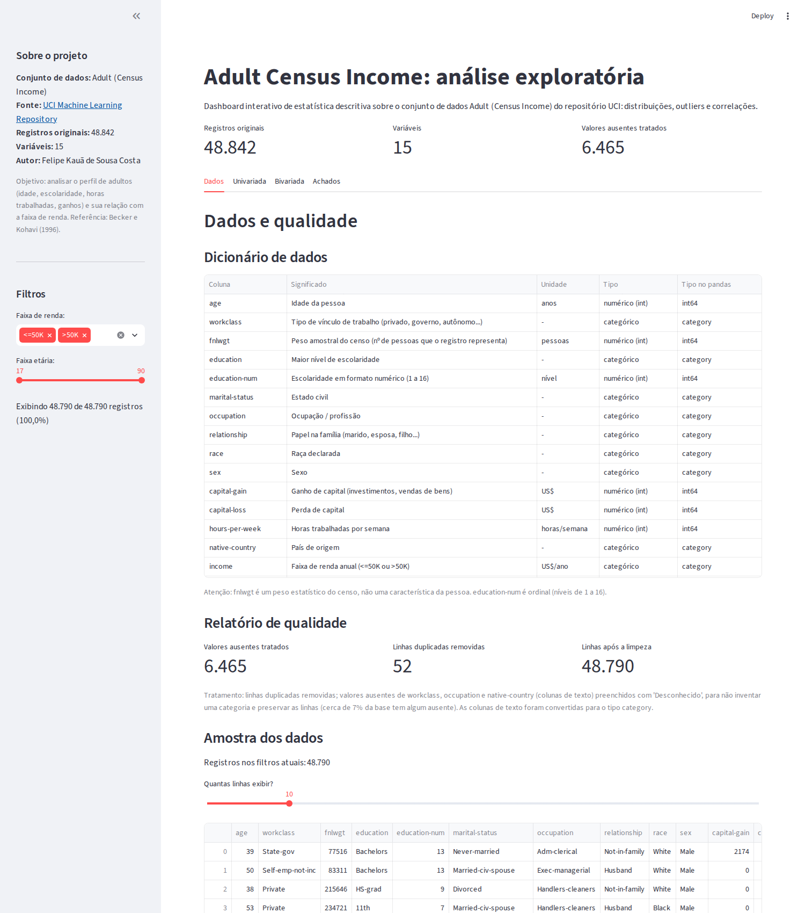
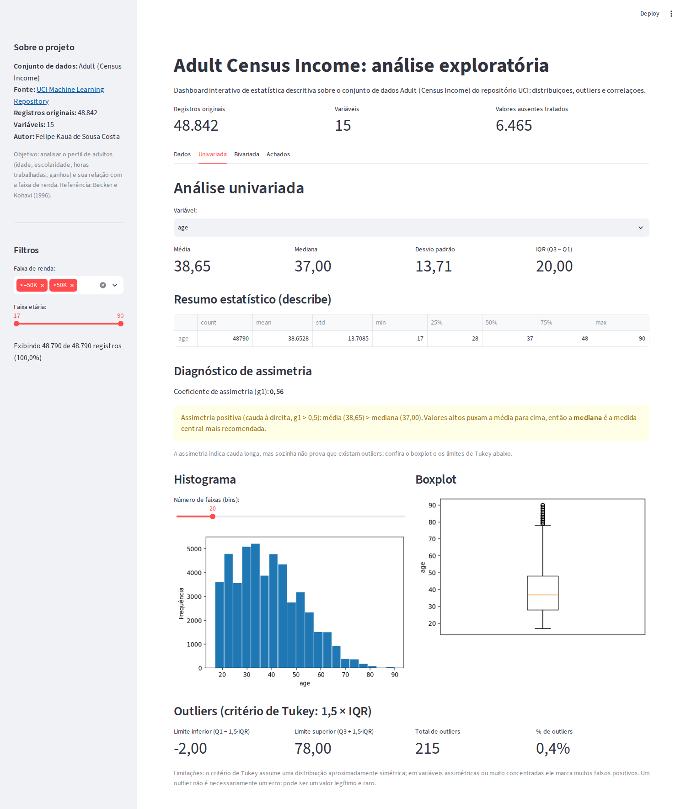
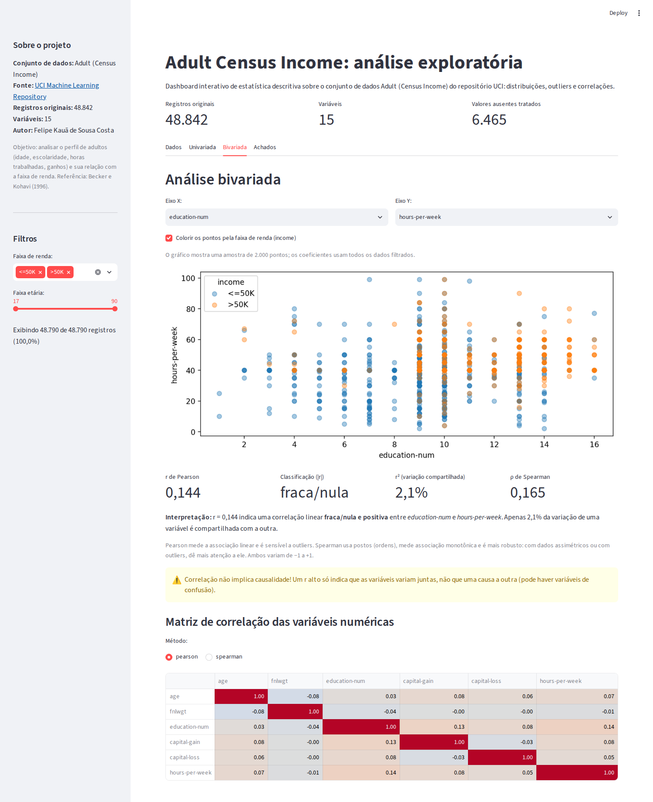
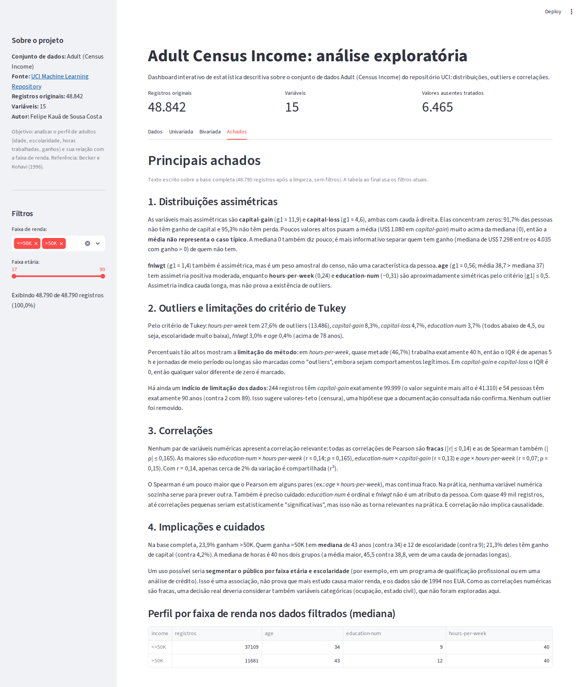

# Adult Census Income: Dashboard de Análise Exploratória

Dashboard interativo em **Streamlit** e **pandas** que explora o conjunto de dados *Adult (Census Income)*
do UCI Machine Learning Repository: qualidade dos dados, distribuições, outliers (critério de Tukey)
e correlações (Pearson e Spearman), com filtros dinâmicos e um texto de achados baseado nos números reais.

> **English summary:** an interactive exploratory-data-analysis dashboard built with Streamlit and pandas
> on the UCI Adult (Census Income) dataset (48,842 records). It covers data-quality reporting,
> skewness diagnostics, Tukey outlier detection, Pearson/Spearman correlation and written findings.
> The code is split into testable modules, covered by 56 automated tests and a CI workflow.
> The user interface and analysis text are in Brazilian Portuguese.

## Funcionalidades

| Aba | O que mostra |
|---|---|
| **Dados** | Dicionário de dados (significado, unidade, tipo), relatório de qualidade (ausentes e duplicadas), amostra ajustável |
| **Univariada** | Média, mediana, desvio padrão, IQR, `describe()`, diagnóstico de assimetria (g₁), histograma com bins ajustáveis, boxplot, limites de Tukey e % de outliers |
| **Bivariada** | Dispersão com eixos configuráveis e cor por faixa de renda, r de Pearson (com r² e interpretação), ρ de Spearman, matriz de correlação |
| **Achados** | Análise escrita sobre assimetria, outliers, correlações e limitações, mais um perfil por faixa de renda que acompanha os filtros |

A barra lateral traz a identificação do dataset e dois filtros (faixa de renda e faixa etária) que atualizam todas as abas,
com contador de registros. Casos como filtro vazio, variável constante ou poucos registros mostram um aviso em vez de falhar.

## Principais achados

- **Assimetria:** `capital-gain` (g₁ ≈ 11,9) e `capital-loss` (g₁ ≈ 4,6) têm mais de 90% de zeros, então a média engana e a mediana é mais informativa.
- **Outliers:** o critério de Tukey marca 27,6% de `hours-per-week`, mas são jornadas legítimas: quase metade trabalha exatamente 40 h, e o IQR de apenas 5 h faz o método falhar. Nenhum outlier foi removido.
- **Correlações:** todas fracas (|r| ≤ 0,14 no Pearson, |ρ| ≤ 0,165 no Spearman); nenhuma variável numérica prevê outra sozinha.
- **Indício de valor-teto:** 244 registros com `capital-gain` exatamente 99.999 (o seguinte é 41.310), hipótese que a documentação não confirma.

## Capturas de tela






## Como executar

Requer Python 3.11 ou superior (testado com 3.12).

```bash
git clone <url-do-repositorio>
cd adult-census-income-dashboard

python -m venv .venv
source .venv/bin/activate        # Windows: .venv\Scripts\activate
pip install -r requirements.txt

streamlit run app.py
```

O app abre em http://localhost:8501.

## Testes e qualidade de código

```bash
pip install -r requirements-dev.txt
pytest                # 56 testes
ruff check .          # lint
ruff format --check . # formatação
```

A suíte cobre as funções estatísticas (incluindo um exemplo didático de Tukey), a limpeza dos dados,
o script de geração do dataset, o comportamento do app em execução (filtros, casos de borda, gráficos)
e **os números citados no texto dos achados**, que são conferidos contra os dados para o texto não ficar
desatualizado. Os testes foram executados com pandas 3.0.2 e 2.2.3 e Streamlit 1.66.
O workflow `.github/workflows/ci.yml` roda lint e testes a cada push.

## Estrutura do projeto

```
adult-census-income-dashboard/
├── app.py                    # ponto de entrada do Streamlit
├── adult_dashboard/
│   ├── data.py               # leitura, limpeza e relatório de qualidade
│   ├── stats.py              # limites de Tukey, outliers, classificação de assimetria e correlação
│   ├── plots.py              # figuras do matplotlib
│   ├── views.py              # barra lateral e uma função por aba
│   ├── dictionary.py         # dicionário de dados
│   ├── findings.py           # texto dos achados
│   └── formatting.py         # formatação numérica (pt-BR)
├── scripts/build_dataset.py  # gera data/adult.csv a partir dos arquivos originais da UCI
├── data/adult.csv
├── tests/
├── docs/images/              # capturas de tela
├── .github/workflows/ci.yml
├── requirements.txt          # dependências de execução
├── requirements-dev.txt      # + pytest e ruff
└── pyproject.toml            # configuração do ruff e do pytest
```

## Dados

- **Fonte:** [Adult, UCI Machine Learning Repository](https://archive.ics.uci.edu/dataset/2/adult).
  Becker, B. e Kohavi, R. (1996). *Adult*. https://doi.org/10.24432/C5XW20. Licença CC BY 4.0.
- **Conteúdo:** censo americano de 1994, 48.842 registros, 15 colunas (6 numéricas e 9 categóricas). Os nomes das colunas são os da documentação da UCI.
- **Origem de `data/adult.csv`:** gerado por `scripts/build_dataset.py`, que concatena `adult.data` e `adult.test`
  (baixados da página acima, em *Data Folder*), pula a linha de cabeçalho do `adult.test` e remove o ponto final dos rótulos de `income`
  (`<=50K.`). Ausentes (`?`) ficam em branco e nenhuma linha é descartada nessa etapa.

```bash
python scripts/build_dataset.py --train adult.data --test adult.test --output data/adult.csv
```

### Decisões de tratamento

- **Duplicadas:** 52 linhas idênticas em todas as colunas foram removidas (48.790 restantes).
- **Ausentes:** 6.465 valores em `workclass`, `occupation` e `native-country`, todos em colunas de texto.
  Foram rotulados "Desconhecido" em vez de removidos (cerca de 7% das linhas teriam sido perdidas) ou imputados pela moda (que criaria concentração artificial).
  Ausentes numéricos, se existissem, seriam preenchidos com a mediana.
- **Tipos:** colunas de texto viram `category`; as numéricas permanecem `int64`.
- **Outliers:** apenas identificados e discutidos, nunca removidos automaticamente.

## Limitações

- Os dados são de 1994 (EUA) e não refletem a realidade atual; as conclusões descrevem a base, não causas.
- O critério de Tukey assume distribuição aproximadamente simétrica e gera falsos positivos em variáveis assimétricas ou muito concentradas; o app avisa isso na tela.
- Os quartis usam a interpolação linear padrão do pandas, que pode diferir levemente do método da "mediana das metades" em amostras muito pequenas.
- O gráfico de dispersão usa uma amostra de 2.000 pontos para manter a interface rápida; os coeficientes usam todos os dados filtrados.
- O texto da aba Achados descreve a base completa, sem filtros.

## Licença

Código sob licença [MIT](LICENSE). O dataset segue a licença CC BY 4.0 da UCI.

## Autor

**Felipe Kauã de Sousa Costa**
